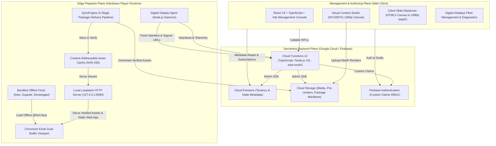
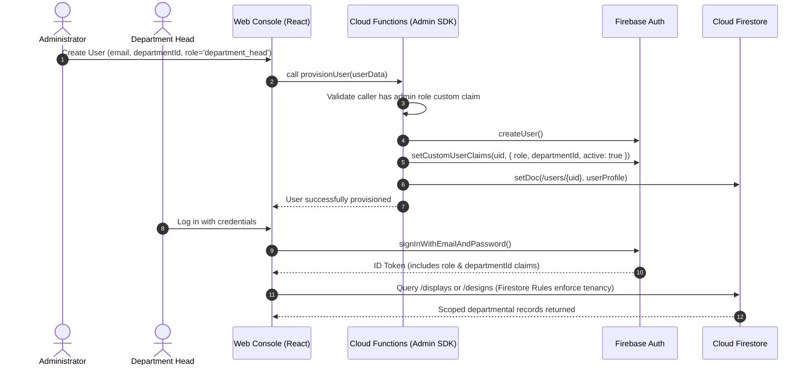
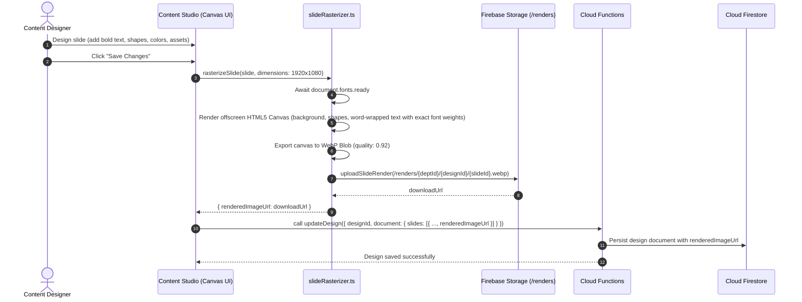
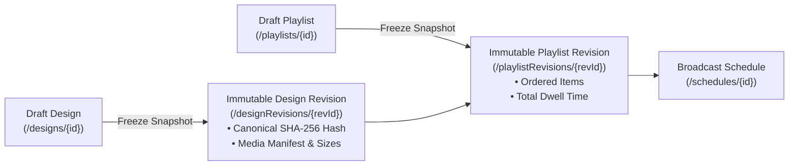
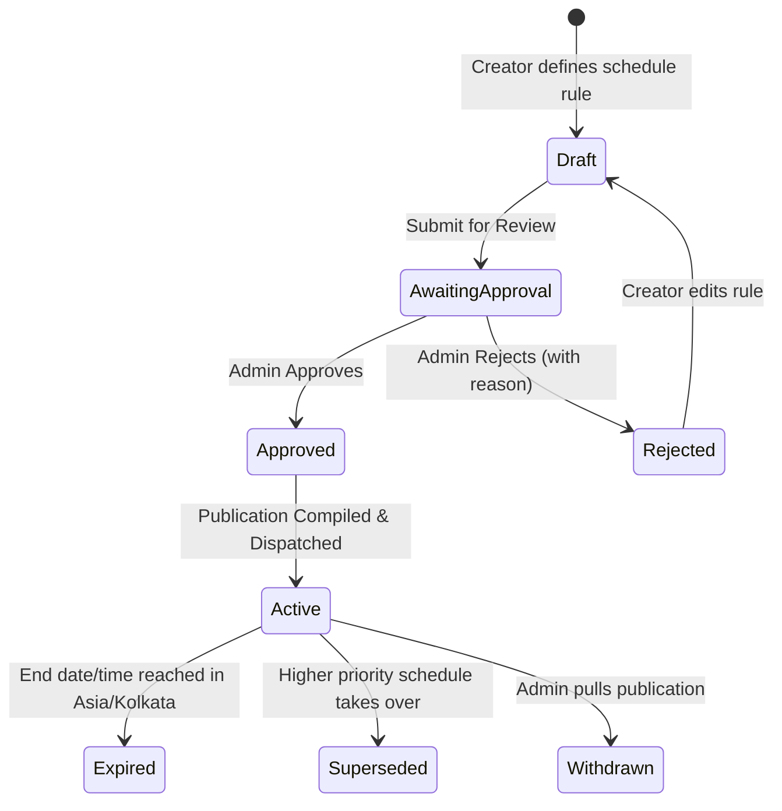
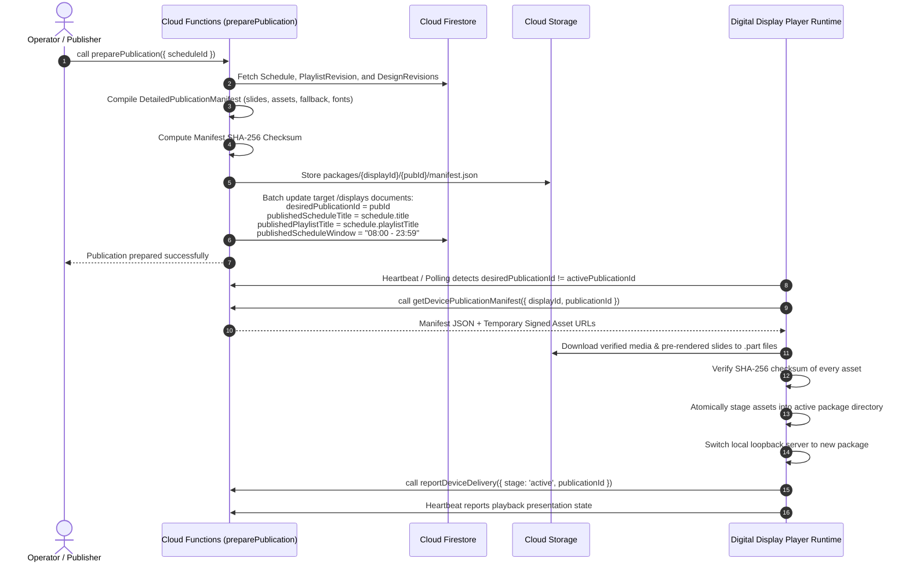
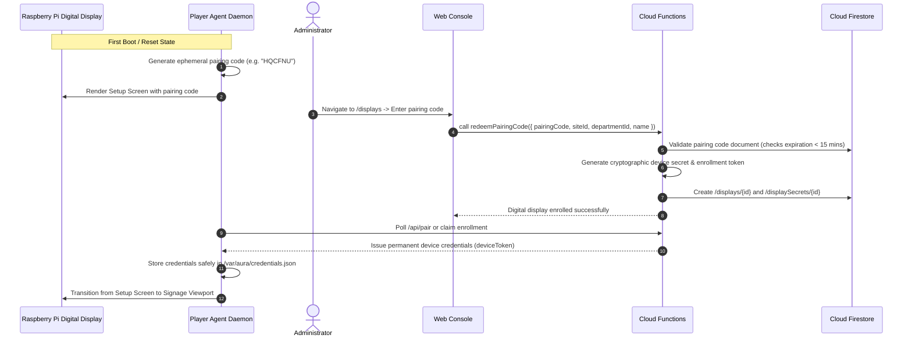
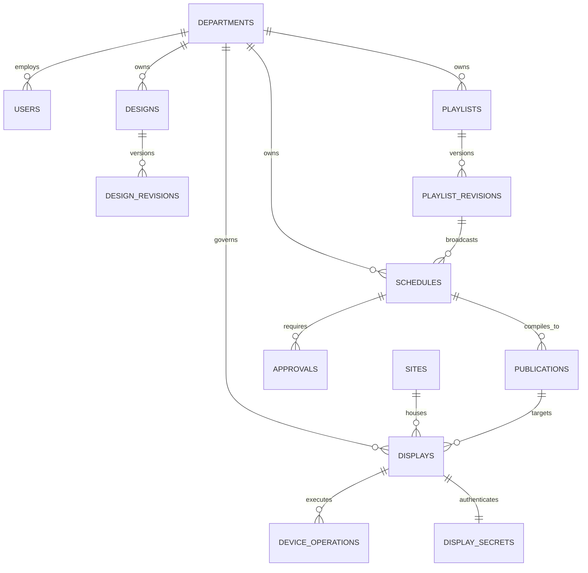

# Aura DIMS — Master System Architecture & Developer Guide

**Company:** Aurainteract Private Limited  
**Product:** Aura DIMS (Aura Digital Information Management System)  
**System Purpose:** Enterprise Digital Signage, Visual Canvas Studio, and Offline-First Playback Management  
**System Scheduling Timezone:** `Asia/Kolkata` (Indian Standard Time, UTC+05:30)  
**Supported Content Languages:** English, Gujarati, and Hindi (Complex Devanagari script shaping)  

---

## 1. Ground Rules & Behavioral Guidelines

1. **Terminology Requirement:**
   - Always use the term **"digital display"** in all user-facing copy, logs, documentation, code comments, and UI components. Never use bare words like "screen", "monitor", or "TV".
2. **Offline Signage Playback Integrity:**
   - Client digital display players operate autonomously using local hardware clocks in `Asia/Kolkata`.
   - Slide transitions and schedule evaluations **NEVER** depend on live network pings, Cloud Functions, or Firestore subscriptions during active presentation.
   - All downloaded assets are verified via SHA-256 checksums before atomic publication manifest activation.
3. **Strict Emulator Mode for Local Development:**
   - All local development and automated rules tests execute strictly against the Firebase Emulator Suite using the demo project ID `demo-aura-dims`.
   - Never fall back silently to live Google Cloud or Firebase services without explicit `--project aura-dims` flags.
   - Service account credentials MUST NOT be injected into client applications.
4. **Privileged Operations Boundary:**
   - The web client SDK performs reads and permitted draft edits only within authorized bounds.
   - Privileged operations (role assignment, digital display enrollment, publishing immutable manifests, approving content, device operations) **MUST** be executed through backend Cloud Functions using the Firebase Admin SDK.
   - Cloud Functions using the Admin SDK bypass Security Rules; therefore, **functions implement explicit authorization and departmental tenancy checks** before mutating data.

---

## 2. High-Level System Architecture

Aura DIMS is architected as an offline-first, distributed enterprise digital signage platform composed of four core layers:



---

## 3. Monorepo Structure

The Aura DIMS codebase is organized as a pnpm workspace with strict boundaries between domain types, backend functions, frontend web application, and hardware player runtime:

```
aura-dims/
├── apps/
│   └── web/                   # Vite + React 19 + TypeScript + Tailwind management console
│       ├── src/
│       │   ├── components/    # Reusable UI widgets, Modals, Drawers
│       │   │   ├── Displays/  # Fleet cards, DisplayDetailsDrawer (Telemetry, Diagnostics)
│       │   │   ├── Editor/    # Visual Content Creator, Canvas, Properties, Thumbnails
│       │   │   ├── Media/     # Media Library, Uploaders, Asset Pickers
│       │   │   ├── Rollout/   # Bulk import, Commissioning checklists, CSV exports
│       │   │   └── Schedules/ # Timeline visualizer, Schedule creator modals
│       │   ├── contexts/      # AuthContext, Role guards
│       │   ├── lib/           # Firebase client, API callable wrappers, slideRasterizer
│       │   └── pages/         # Dashboard, Displays, Content, Playlists, Schedules, Users
│       └── vite.config.ts
├── functions/                 # 2nd Gen Firebase Cloud Functions in TypeScript (asia-south1)
│   ├── src/
│   │   ├── credentials.ts     # Device cryptographic token generation & validation
│   │   ├── designAdmin.ts     # Design CRUD, validation, and cloning
│   │   ├── deviceOperations.ts# Reboot, Screenshot, Renderer Refresh handlers
│   │   ├── fleetAdmin.ts      # Digital display enrollment, pairing, and heartbeat ingestion
│   │   ├── mediaAdmin.ts      # Upload initialization, SHA-256 validation, thumbnailing
│   │   ├── operational.ts     # Scheduled maintenance, stale upload cleanup
│   │   ├── publishingAdmin.ts # Playlist freezing, publication compilation, rollback
│   │   └── rolloutAdmin.ts    # Bulk digital display import and provisioning
│   ├── package.json
│   └── tsconfig.json
├── packages/
│   └── display-schema/        # Canonical TypeScript types, Zod/Joi contracts, constraints
│       ├── src/
│       │   └── index.ts       # Shared data models (DigitalDisplay, DesignSlide, Manifest)
│       └── package.json
├── player/                    # Autonomous Digital Display client runtime
│   ├── src/
│   │   ├── agent/             # System daemon (systemd service)
│   │   │   ├── config.ts      # Hardware and network configuration
│   │   │   ├── hardwareAdapter.ts # Linux CPU temp, RAM, Disk, Uptime probes
│   │   │   ├── identity.ts    # Device pairing, credentials storage, token rotation
│   │   │   ├── localServer.ts # Loopback HTTP server (127.0.0.1:8090)
│   │   │   ├── operationsAgent.ts # Remote operation executor (scrot screenshot, reboot)
│   │   │   ├── supervision.ts # Health watchdogs, heartbeat timer
│   │   │   ├── syncEngine.ts  # 4-stage publication downloader & SHA-256 verifier
│   │   │   └── transport.ts   # Authenticated Cloud Functions RPC transport
│   │   └── renderer/          # Fullscreen Chromium viewport web application
│   │       ├── fonts/         # Bundled offline .woff2 fonts (Inter, Gujarati, Devanagari)
│   │       ├── index.html     # Signage HTML shell
│   │       ├── renderer.css   # Offline @font-face rules, dual-buffer crossfade transitions
│   │       └── renderer.js    # Autonomous schedule evaluator and dual-buffer player
│   ├── package.json
│   └── tsconfig.json
├── firebase/
│   └── emulators/data/        # Persistent emulator export directory
├── docs/                      # Architectural, data model, and service documentation
├── tests/
│   ├── rules/                 # Vitest Security Rules unit tests
│   └── e2e/                   # Playwright smoke test suite
├── firebase.json              # Firebase services and emulator configuration
├── firestore.rules            # Deny-by-default Firestore rules
├── storage.rules              # Deny-by-default Storage rules
├── firestore.indexes.json     # Firestore composite indexes definition
└── .firebaserc                # Firebase project aliases (demo-aura-dims default)
```

---

## 4. End-to-End System Flows

### Flow 1: Authentication & Role-Based Access Control (RBAC)

Aura DIMS implements strict departmental multi-tenancy and hierarchical role-based access control.



#### Roles and Permission Matrix

| Capability | Administrator (`admin`) | Department Head (`department_head`) | Digital Display Player (`device`) |
| :--- | :---: | :---: | :---: |
| **User & Role Provisioning** | Full Access | No Access | No Access |
| **Department Management** | Full Access | Read-Only (Own Dept) | No Access |
| **Site Management** | Full Access | Read-Only | No Access |
| **Digital Display Enrollment / Pairing** | Generate Pairing Codes | View Assigned Displays | Auto-Provision via Code |
| **Media Library Uploads** | All Departments | Own Department Only | No Access (Read via Manifest) |
| **Design Canvas Authoring** | All Designs | Own Department Designs | No Access |
| **Playlist Management** | All Playlists | Own Department Playlists | Read via Manifest |
| **Schedule Creation** | All Schedules | Own Department Schedules | Read via Manifest |
| **Direct Publishing** | Granted (or privileged) | Requires Approval | No Access |
| **Publishing Approvals** | Approve / Reject | Submit for Review | No Access |
| **Remote Device Operations** | Reboot, Scrot, Refresh | Refresh / Scrot (Own Dept) | Executes Locally |

---

### Flow 2: Content Creation & Slide Pre-Rendering (Approach A)

To eliminate font rendering discrepancies, missing Linux fonts, and bold weight flattening across heterogeneous commercial display hardware, Aura DIMS pre-renders slides into high-resolution images upon saving.



#### Key Technical Highlights of Slide Rasterization:
- **Canvas Resolution:** Fixed to logical display dimensions (`1920×1080` for landscape, `1080×1920` for portrait).
- **Typography Synchronization:** Calls `await document.fonts.ready` prior to canvas drawing to ensure Google Fonts / Fontsource `.woff2` font faces are loaded into memory.
- **Explicit Weight Normalization:** Converts weights to `'700'` (bold), `'600'` (medium), or `'400'` (regular) to match exact font-face descriptors.
- **Storage Path:** Uploaded directly to `/renders/{departmentId}/{designId}/{slideId}.webp` with aggressive cache headers (`public, max-age=31536000`).

---

### Flow 3: Playlists, Revisions & Immutable Freezing

Content is grouped into sequential playlists. To guarantee audit compliance and playback repeatability, playlists and designs are frozen into immutable revision snapshots before broadcast.



1. **Content Hashing:** Cloud Function `freezeDesignRevision` computes a canonical JSON SHA-256 hash of the design document.
2. **Asset Verification:** Inspects every asset reference in `doc.slides`, verifies that the asset is in `ready` status in the Media Library, and records file size, MIME type, and SHA-256 checksum in `assetManifest`.
3. **Immutability Guarantee:** Once created, `DesignRevision` and `PlaylistRevision` documents are strictly read-only and never modified.

---

### Flow 4: Broadcast Scheduling & Approval Governance

Broadcast schedules govern when and where content plays, evaluated strictly against Indian Standard Time (`Asia/Kolkata`).



#### Schedule Rule Constraints:
- **Timezone:** Fixed to `Asia/Kolkata` (UTC+05:30).
- **Recurrence:** `one_time` (specific date range) or `recurring` (days of the week: `0=Sun` ... `6=Sat`).
- **Active Hours:** `startTime` and `endTime` in 24-hour format (`HH:mm`), with `isOvernight` support.
- **Priority Tiers:** Integer priority `1` (lowest) to `10` (Emergency Override). Higher priority preempts lower priority broadcasts.

---

### Flow 5: Publication Manifest Compilation & Delivery Pipeline

The publication manifest is the authoritative, self-contained deployment package delivered to edge digital displays.



#### 4-Stage Separation on Digital Displays:

| Stage | Field on DigitalDisplay | Description |
| :--- | :--- | :--- |
| **1. Desired** | `desiredPublicationId` | Target publication assigned by the operator in the cloud. |
| **2. Staged** | `readyPublicationId` | Package downloaded, SHA-256 verified, and ready on local disk. |
| **3. Active** | `activePublicationId` | Activated package linked into the player's local runtime. |
| **4. Presented** | `presentedPublicationId` | Publication actually rendered and currently visible on the physical screen. |

---

### Flow 6: Digital Display Enrollment & Pairing

Unprovisioned hardware connects securely to Aura DIMS via short-lived pairing codes:



---

### Flow 7: Digital Display Player Runtime Architecture

The player runs on Raspberry Pi OS (Debian Linux) or commercial signage hardware as an autonomous kiosk daemon:

```
┌─────────────────────────────────────────────────────────────────────────────┐
│                       Physical Digital Display Hardware                     │
│                                                                             │
│  ┌───────────────────────────────────────────────────────────────────────┐  │
│  │                    Chromium Browser (Kiosk Viewport)                  │  │
│  │  - Running in fullscreen kiosk mode: DISPLAY=:0 chromium-browser     │  │
│  │  - URL: http://127.0.0.1:8090/ (Loopback, zero internet dependency)   │  │
│  │  - Dual-buffer DOM (Slot A / Slot B) for 0.28s crossfades             │  │
│  │  - Bundled offline @font-face fonts (Inter, Gujarati, Devanagari)     │  │
│  │  - Hardware watchdog (15s transition watchdog)                        │  │
│  └──────────────────────────────────▲────────────────────────────────────┘  │
│                                     │ Local HTTP / Static                   │
│  ┌──────────────────────────────────┴────────────────────────────────────┐  │
│  │               Node.js Agent Daemon (systemd: aura-player)             │  │
│  │                                                                       │  │
│  │  ┌────────────────────────┐         ┌──────────────────────────────┐  │  │
│  │  │  Loopback Server:8090  │         │  Hardware Telemetry Adapter  │  │  │
│  │  │  - Static renderer     │         │  - CPU Temp (/sys/class/...) │  │  │
│  │  │  - /api/assets/:id     │         │  - RAM (os.freemem / total)  │  │  │
│  │  │  - /api/status         │         │  - Disk free/total (statvfs) │  │  │
│  │  │  - /api/playback-event │         │  - Uptime & Boot ID          │  │  │
│  │  └────────────────────────┘         └──────────────────────────────┘  │  │
│  │                                                                       │  │
│  │  ┌─────────────────────────────────────────────────────────────────┐  │  │
│  │  │  SyncEngine: 4-Stage Download & Verification Pipeline           │  │  │
│  │  │  - Streams assets to *.part files                               │  │  │
│  │  │  - Validates SHA-256 hashes against package manifest            │  │  │
│  │  │  - Content-Addressable Cache (/var/aura/cache/<sha256>)         │  │  │
│  │  │  - Safe cache cleanup when disk space is low (< 1 GB)           │  │  │
│  │  └─────────────────────────────────────────────────────────────────┘  │  │
│  │                                                                       │  │
│  │  ┌─────────────────────────────────────────────────────────────────┐  │  │
│  │  │  Operations Agent: Remote diagnostics executor                   │  │  │
│  │  │  - CAPTURE_PREVIEW: captures screen via X11 scrot utility       │  │  │
│  │  │  - REBOOT: executes controlled systemctl reboot                 │  │  │
│  │  │  - REFRESH_RENDERER: increments generation counter              │  │  │
│  │  └─────────────────────────────────────────────────────────────────┘  │  │
│  └──────────────────────────────────▲────────────────────────────────────┘  │
└─────────────────────────────────────┼───────────────────────────────────────┘
                                      │ HTTPS RPC / Heartbeat (30-60s)
                                      ▼
                        Google Cloud / Firebase Backend
```

---

## 5. Comprehensive Firestore Data Model

All collections enforce strict data isolation, tenancy tags, and audit fields (`createdAt`, `updatedAt`, `createdBy`).



### Collection Specifications

#### 1. `/users/{uid}`
- `uid` (string): Firebase Authentication UID.
- `email` (string): Operator corporate email address.
- `displayName` (string): Full name of the user.
- `role` (`'admin' | 'department_head'`): System privilege level.
- `departmentId` (string): Associated department identifier.
- `active` (boolean): Whether account access is active or suspended.
- `canDirectPublish` (boolean): Optional administrative bypass for approval workflows.

#### 2. `/departments/{departmentId}`
- `id` (string): Unique department ID (e.g. `dept_operations`).
- `name` (string): Human-readable name (e.g. `Operations & Safety`).
- `code` (string): 2-5 character uppercase badge code (e.g. `OPS`).
- `active` (boolean): Operational status.

#### 3. `/sites/{siteId}`
- `id` (string): Unique enterprise site ID (e.g. `site_surat_plant`).
- `name` (string): Facility name (e.g. `Surat Manufacturing Complex`).
- `location` (string): City, state, or geo-coordinates.

#### 4. `/displays/{displayId}`
- `id` (string): Unique digital display ID (e.g. `xZ6E9iHq925ADhxkx0Tp`).
- `name` (string): Display label (e.g. `Plant A Entrance Digital Display`).
- `siteId` (string): Associated physical site.
- `departmentId` (string): Governing department.
- `orientation` (`'landscape' | 'portrait'`): Visual presentation layout.
- `configuredResolution` (`{ width: number, height: number }`): 1920x1080 or 1080x1920.
- `lifecycle` (`'active' | 'maintenance' | 'decommissioned'`): Display operational state.
- `desiredPublicationId` (string | null): Target publication requested by cloud operator.
- `activePublicationId` (string | null): Publication currently activated on hardware disk.
- `presentedPublicationId` (string | null): Publication currently rendered on viewport.
- `publishedScheduleId` (string | null): ID of active schedule.
- `publishedScheduleTitle` (string | null): Title of active schedule for UI cards.
- `publishedPlaylistTitle` (string | null): Title of assigned playlist.
- `publishedScheduleWindow` (string | null): Operating hours string (e.g. `08:00 - 23:59`).
- `deliveryStage` (`'idle' | 'downloading' | 'verifying' | 'active' | 'failed'`): Telemetry state.
- `lastHeartbeatAt` (ISO-8601 string): Server receipt time of last accepted heartbeat.
- `reported` (object | null): Dynamic hardware telemetry from device (CPU, RAM, storage, etc.).

#### 5. `/displaySecrets/{displayId}`
- **Security:** Private collection accessible strictly by Cloud Functions via the Admin SDK.
- `deviceSecretHash` (string): Argon2/SHA-256 hash of device communication secret.
- `activeDeviceUid` (string): Firebase Auth UID representing the device.
- `lastRotatedAt` (string): Timestamp of last credential issuance.

#### 6. `/assets/{assetId}`
- `id` (string): Unique media asset identifier.
- `departmentId` (string): Owning department.
- `fileName` (string): Original uploaded filename.
- `mimeType` (`'image/jpeg' | 'image/png' | 'image/webp' | 'video/mp4'`): Media format.
- `fileSizeBytes` (number): File size in bytes.
- `checksumSha256` (string): Cryptographic SHA-256 digest computed on storage finalization.
- `storagePath` (string): Permanent path in Cloud Storage (`media/{deptId}/{assetId}/{fileName}`).
- `thumbnailPath` (string | null): Derived preview thumbnail.
- `status` (`'staging' | 'validating' | 'ready' | 'failed' | 'archived'`): Media readiness.

#### 7. `/designs/{designId}`
- `id` (string): Unique design document ID.
- `title` (string): Content title.
- `orientation` (`'landscape' | 'portrait'`): Target layout.
- `dimensions` (`{ width: number, height: number }`): 1920x1080 / 1080x1920.
- `departmentId` (string): Owning department.
- `revision` (number): Monotonic draft edit counter.
- `document` (object): Canvas document schema:
  - `schemaVersion`: `'1.0.0'`
  - `slides` (array of `DesignSlide`):
    - `id` (string): Unique slide ID.
    - `durationSeconds` (number): Dwell time (min 3s, max 300s).
    - `background`: `{ type: 'color'|'gradient'|'asset', value: string, assetId?: string }`
    - `renderedImageUrl` (string | null): Pre-rendered 1080p WebP image URL.
    - `elements` (array of `CanvasElement`): Text, Shape, Image, Video elements.

#### 8. `/designRevisions/{revisionId}`
- Immutable snapshot of `/designs/{id}` at a specific revision point.
- Stores canonical `contentHash` (SHA-256), `referencedAssetIds`, `assetManifest`, and `requiredFonts`.

#### 9. `/playlists/{playlistId}` & `/playlistRevisions/{revisionId}`
- Ordered sequence of design revision IDs with dwell durations and transitions.

#### 10. `/schedules/{scheduleId}`
- `id` (string): Schedule ID.
- `title` (string): Human-readable broadcast label.
- `playlistRevisionId` (string): Frozen playlist revision being broadcast.
- `playlistTitle` (string): Cached title for fast queries.
- `targetDisplayIds` (string[]): Enrolled digital displays targeted by this broadcast.
- `scheduleRule` (`ScheduleRule`):
  - `scheduleType`: `'one_time' | 'recurring'`
  - `startDate`, `endDate`: `YYYY-MM-DD`
  - `daysOfWeek`: array of `0-6`
  - `startTime`, `endTime`: `HH:mm` (Asia/Kolkata)
  - `isOvernight`: boolean
  - `priority`: 1 to 10
- `status`: `'draft' | 'awaiting_approval' | 'approved' | 'active' | 'withdrawn' | 'expired'`
- `publishedPublicationId` (string | null): Pointer to compiled publication package.

#### 11. `/publications/{publicationId}`
- Authoritative publication package metadata and pointer to `packages/{displayId}/{pubId}/manifest.json` in Cloud Storage.

#### 12. `/deviceOperations/{operationId}`
- Remote device management queue records (`CAPTURE_PREVIEW`, `REFRESH_RENDERER`, `REBOOT_DEVICE`, `SAFE_CACHE_CLEANUP`).
- Tracks lifecycle: `requested` -> `claimed` -> `executing` -> `completed` / `failed`.

---

## 6. Cloud Storage Structure & Security Rules

Cloud Storage organizes files into strict directories governed by [`storage.rules`](file:///d:/DEEP/aura-dims/storage.rules):

```
gs://aura-dims.firebasestorage.app/
├── staging/{departmentId}/{assetId}/{fileName}     # Direct client uploads (size <= 200 MB)
├── media/{departmentId}/{assetId}/{fileName}       # Verified media assets (Admin SDK only)
├── thumbnails/{departmentId}/{assetId}/{fileName}  # Scaled thumbnails for web console
├── renders/{departmentId}/{designId}/{slideId}.webp# 1080p WebP slide renders (Public read)
├── previews/{displayId}/{fileName}                 # On-demand screenshot captures (scrot)
└── packages/{displayId}/{publicationId}/           # Immutable publication manifests
    └── manifest.json
```

---

## 7. Digital Display Player Runtime Architecture (Agent & Renderer)

### Local Configuration (`/home/aura/player/data/config.json`)
```json
{
  "host": "127.0.0.1",
  "port": 8090,
  "rendererVersion": "1.2.0",
  "maxFileSizeBytes": 209715200,
  "maxPackageSizeBytes": 1073741824,
  "minFreeDiskBytes": 1073741824,
  "heartbeatIntervalSeconds": 30,
  "pollIntervalSeconds": 60
}
```

### Systemd Service Configuration (`/etc/systemd/system/aura-player.service`)
```ini
[Unit]
Description=Aura DIMS Digital Display Player
After=network-online.target
Wants=network-online.target

[Service]
Type=simple
User=aura
WorkingDirectory=/home/aura/player
Environment=NODE_ENV=production
Environment=FIREBASE_PROJECT_ID=aura-dims
Environment=AURA_DATA_DIR=/home/aura/player/data
ExecStart=/usr/bin/node /home/aura/player/dist/index.js
Restart=always
RestartSec=5s

[Install]
WantedBy=multi-user.target
```

### Kiosk Launch Script (`/home/aura/start-kiosk.sh`)
```bash
#!/bin/bash
# Disable screen blanking, screensaver, and power management
xset s off
xset s noblank
xset -dpms

# Hide mouse cursor when inactive
unclutter -idle 0.5 -root &

# Launch Chromium in kiosk mode against local loopback service
sed -i 's/"exited_cleanly":false/"exited_cleanly":true/' ~/.config/chromium/Default/Preferences
sed -i 's/"exit_type":"Crashed"/"exit_type":"Normal"/' ~/.config/chromium/Default/Preferences

chromium-browser \
  --noerrdialogs \
  --disable-infobars \
  --kiosk \
  --check-for-update-interval=31536000 \
  --disable-translate \
  --autoplay-policy=no-user-gesture-required \
  --app=http://127.0.0.1:8090/
```

---

## 8. Developer Commands & Workflows

### 8.1 Workspace Commands

| Action | Command | Scope / Notes |
| :--- | :--- | :--- |
| **Install Dependencies** | `pnpm install` | Installs dependencies across all workspace projects |
| **Run Dev Environment** | `pnpm run dev` | Concurrently starts Emulators & React dev server |
| **Start Emulators Only** | `pnpm run emulators:start` | Runs Auth, Firestore, Functions, Storage emulators |
| **Export Emulator State** | `pnpm run emulators:export`| Dumps state to `firebase/emulators/data` |
| **Typecheck Everything** | `pnpm run typecheck` | Strict `tsc --noEmit` across all 4 workspaces |
| **Build Everything** | `pnpm run build` | Builds schema tarball, functions, player, and web bundle |
| **Build Web Only** | `pnpm --filter @aura-dims/web build` | Produces production assets in `apps/web/dist` |
| **Build Functions Only** | `pnpm run build:functions` | Re-packs `@aura-dims/display-schema` & compiles functions |
| **Security Rules Tests** | `pnpm run test:rules` | Runs Vitest security unit tests |
| **E2E Smoke Tests** | `pnpm run test:e2e` | Runs Playwright tests against web UI |

### 8.2 Deployment Commands

#### Web Application (Frontend)
- Continuous deployment is active on **Vercel** linked to GitHub branch `main`.
- To deploy updates:
  ```bash
  git add .
  git commit -m "feat: your descriptive change"
  git push origin main
  ```
- Live Web Console: [https://aura-dims.vercel.app](https://aura-dims.vercel.app)

#### Backend Cloud Functions & Storage Rules
- Deploy exclusively with the target project flag:
  ```bash
  # Deploy Cloud Storage Security Rules
  npx firebase deploy --only storage --project aura-dims

  # Deploy Cloud Functions (Node.js 24 / asia-south1)
  npx firebase deploy --only functions --project aura-dims
  ```

#### Raspberry Pi Digital Display Player Runtime
- To deploy compiled player updates and offline fonts to physical hardware:
  ```bash
  # 1. Build the player workspace
  pnpm --filter @aura-dims/player build

  # 2. Deploy dist and renderer files to Raspberry Pi over SSH/SFTP
  python scratch/deploy_player_to_rpi.py
  ```

---

## 9. Troubleshooting & Common Operational Scenarios

### Scenario 1: Bold Letters Displaying as Regular Text on Digital Display
- **Root Cause:** Chromium on Raspberry Pi OS lacks Google Fonts when operating offline or times out fetching web fonts, falling back to Linux DejaVu Sans.
- **Resolution:**
  1. Slide pre-rendering (Approach A) converts slides into 1080p WebP images upon clicking "Save" in Content Studio.
  2. Bundled local `.woff2` font files in `player/src/renderer/fonts/` with `@font-face` rules in `renderer.css` guarantee instant offline font resolution for both DOM fallbacks and system screens.
  3. Re-publish the schedule to push the updated WebP image manifest to the digital display.

### Scenario 2: Digital Display Device Card Shows "None Assigned" for Schedule or Playlist
- **Root Cause:** Older displays or publications compiled prior to schema enrichment did not record schedule metadata directly on `/displays/{id}`.
- **Resolution:**
  - `DisplaysPage.tsx` automatically executes a real-time join against active `/schedules` documents.
  - To record metadata permanently on the digital display document, open `/schedules`, select the active schedule, and click **"Publish"**. Backend function `preparePublication` will write `publishedScheduleTitle`, `publishedPlaylistTitle`, and `publishedScheduleWindow` to the display document.

### Scenario 3: Digital Display Shows Status "Offline"
- **Check Heartbeat:** The device reports heartbeats every 30-60 seconds. Displays with `lastHeartbeatAt > 3 minutes` are flagged `offline`.
- **Diagnostic Steps:**
  1. Verify device network connectivity: `ping 192.168.1.140`
  2. SSH into Raspberry Pi: `ssh aura@192.168.1.140`
  3. Inspect systemd status: `systemctl status aura-player`
  4. Inspect live logs: `journalctl -u aura-player -f -n 50`

### Scenario 4: Taking a Live Screenshot of the Physical Digital Display
- From the Web Console:
  1. Navigate to **Digital Displays Fleet Management** (`/displays`).
  2. Open the **Telemetry & Operations Drawer** for the digital display.
  3. Click **"Capture Software Preview"**.
  4. The Cloud Function creates a `CAPTURE_PREVIEW` operation in `/deviceOperations`.
  5. The Raspberry Pi agent daemon claims the operation, executes `DISPLAY=:0 scrot /tmp/preview.png`, uploads the image to `/previews`, and displays the screenshot in the drawer.

---

## 10. Future Development Roadmap

1. **Video Hardware Decoding Optimization:** Support GPU-accelerated video decoding (`v4l2m2m` / `mmal`) for dual 4K video feeds on Raspberry Pi 4/5 hardware.
2. **Dynamic Widgets:** Clock, live weather, RSS news ticker, and stock ticker widgets evaluated locally in client renderer with offline fallback.
3. **Emergency Alert Broadcast (Priority 10):** Single-click enterprise emergency override that instantly interrupts all active digital displays and broadcasts campus evacuation notices.
4. **Digital Display Hardware Remote Reboot & HDMI CEC Power Control:** Remote TV/screen power on/off over HDMI CEC through the player hardware adapter.
