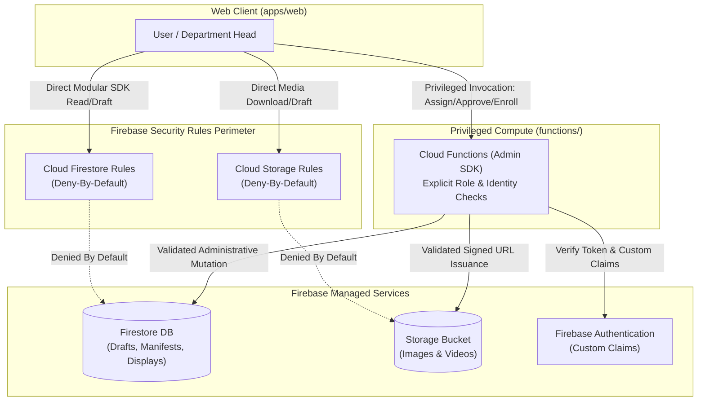
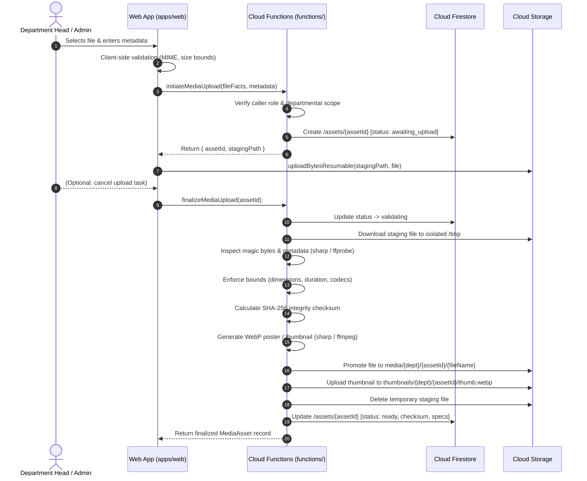
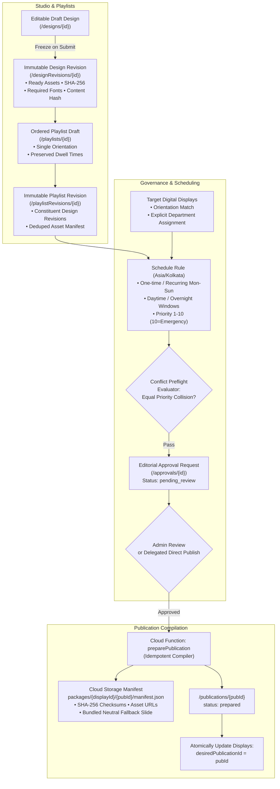

# Aura DIMS - System Architecture Specification

**Company:** Aurainteract Private Limited  
**Product:** Aura Digital Information Management System (Aura DIMS)  
**System Purpose:** Enterprise Digital Signage and Content Management Platform  

---

## 1. Monorepo Architecture & Service Boundaries

Aura DIMS adopts a modular monorepo layout managed by `pnpm workspaces`. This isolates dependencies, establishes clear interface contracts, and prevents leaking backend privileges into client bundles.

```
aura-dims/
├── apps/
│   └── web/                   # Frontend Web Application (React + Vite + Tailwind)
├── functions/                 # Backend Compute & Privileged APIs (Cloud Functions v2)
├── packages/
│   └── display-schema/        # Shared Domain Schemas, Manifest Types & Interfaces
├── player/                    # Signage Player Client Runtime (Documented Placeholder)
├── firebase/
│   └── emulators/data/        # Persistent Local Emulator State
├── docs/                      # Technical Documentation & Service Architecture
└── tests/
    ├── rules/                 # Security Rules Unit Tests
    └── e2e/                   # Playwright Browser Smoke Suite
```

### Boundary Definitions

1. **`apps/web/` (Client Layer):**
   - Implements the administrative portal, visual creator studio, and scheduling consoles.
   - Connects directly to Firebase via the modular Web SDK.
   - **Allowed Client Actions:** Read-only access to published public assets and authorized departmental draft edits.
   - **Forbidden Client Actions:** Direct role self-assignment, direct approval of publications, direct issuance of device credentials, and direct writes to system audit logs.

2. **`functions/` (Backend Privileged Layer):**
   - Cloud Functions for Firebase (v2) implemented in TypeScript and deployed to the `asia-south1` (Mumbai) region.
   - Operates with elevated Firebase Admin SDK privileges.
   - **Mandatory Policy:** Because the Admin SDK completely bypasses Firestore and Storage Security Rules, all Cloud Functions must implement explicit, granular caller identity and role checks before executing mutations.

3. **`packages/display-schema/` (Contract Layer):**
   - Shared TypeScript types, Zod/domain schemas, manifest definitions, and language enumerations (`en`, `gu`, `hi`).
   - Ensures type parity between the administrative frontend, cloud functions, and digital display players.

4. **`player/` (Edge Display Runtime):**
   - Autonomous digital display client runtime (Android kiosk, Web PWA, or Electron).
   - Operates on a pull-and-verify model without direct dependency on cloud backend uptime for slide sequencing.

---

## 2. Privilege Separation & Authorization Model



### 2.1 Core Authorization Principles
1. **Deny by Default:** Cloud Firestore and Cloud Storage start with a total deny posture (`allow read, write: if false;`).
2. **No Role Self-Assignment:** Users can never alter their own roles or custom claims.
3. **No Sole Email Domain Checks:** Authorization is strictly backed by cryptographically signed Firebase Custom Claims issued by backend Cloud Functions.
4. **No Default Known Administrator:** System administrators are provisioned explicitly through authenticated administrative initialization routines rather than pre-seeded hardcoded accounts.
5. **UI Visibility Is Not Security:** Hiding buttons or routes in the web application never substitutes for backend authorization.

### 2.2 Future Role Hierarchy
- **System Administrator:** Unrestricted management of all sites (Ahmedabad, Vadodara, Surat, Rajkot), all departments, user provisioning, and emergency network broadcast overrides.
- **Department Head:** Restricted scope managing content and playlists belonging strictly to their assigned department (e.g. HR, Operations, Safety).
- **Explicit Digital Display Assignments:** A Department Head can only schedule and publish content to digital displays that have been explicitly assigned to them by an Administrator.
- **Digital Display Device Identity:** Digital display players authenticate using separate, distinct device credentials (device tokens/mTLS) rather than human user credentials.

### 2.3 Secure Departmental Media Ingestion & Validation Pipeline

The Media Library enforces a three-stage upload and validation pattern that ensures zero unchecked binaries enter production storage or display manifest publications:



#### Media Constraints & Governance Standards
- **Supported Formats:**
  - **Images:** JPEG, PNG (MIME types `image/jpeg`, `image/png`). Max file size: 20 MB. Max image resolution: 40 Megapixels.
  - **Videos:** MP4 with H.264 video codec and optional AAC audio. Max file size: 200 MB. Max duration: 600s (10 min). Max resolution: 1920×1080 (landscape) or 1080×1920 (portrait).
- **Private Preview Model:**
  - No public download tokens are persisted in Firestore.
  - Previews use short-lived authenticated URLs generated on-demand via `getMediaPreviewUrl` (v4 signed URLs in production; direct emulator endpoints in local mode).
- **Offline Integrity:**
  - SHA-256 checksums are calculated server-side during finalization and stored with the asset for atomic display player verification.
- **Staging Lifecycle & Cleanup:**
  - Upload intents expire after 2 hours. Abandoned staging files and unfinalized intents can be cleaned up via `cleanupExpiredUploads` (supports `dryRun` audit mode).

### 2.4 Visual Content Creator & Reusable Templates Architecture

The Visual Content Creator delivers an enterprise signage authoring studio that guarantees visual fidelity across arbitrary display aspect ratios, prevents accidental loss of unpublished work, and provides seamless typography across supported Indian languages.

```mermaid
flowchart LR
    subgraph ClientEditor["Web Client Studio (apps/web)"]
        CanvasEngine["Logical Canvas Engine\n(1920×1080 / 1080×1920)\nDOM Renderer + Transform Scale"]
        AutosaveMgr["Debounced Autosave Manager\n(2.5s window + Revision Track)"]
        RecoveryCache[("Browser Recovery Cache\nlocalStorage: aura_dims_draft_*")]
    end

    subgraph FontStack["Bundled Font System"]
        InterFont["Inter (English)"]
        GujaratiFont["Noto Sans Gujarati"]
        DevanagariFont["Noto Sans Devanagari (Hindi)"]
    end

    subgraph Backend["Cloud Functions (asia-south1)"]
        UpdateDesignFn["updateDesign(designId, document, revision)"]
        ConflictDetection{"Revision Check:\nExpected == Stored?"}
        IncrementRevision["Monotonic Revision++\nPersist to Firestore"]
        ConflictError["Error: CONFLICT\n(Return Latest Record)"]
    end

    CanvasEngine --- FontStack
    CanvasEngine -->|State Change| AutosaveMgr
    AutosaveMgr -->|Local Backup| RecoveryCache
    AutosaveMgr -->|Save Mutation| UpdateDesignFn
    UpdateDesignFn --> ConflictDetection
    ConflictDetection -->|Yes| IncrementRevision
    ConflictDetection -->|No (Stale)| ConflictError
```

#### 1. DOM-Based Scaled Canvas Rendering
- **Why DOM over Canvas 2D/WebGL:** Indian languages (Devanagari for Hindi and Gujarati) require sophisticated OpenType HarfBuzz shaping, complex conjuncts, and vowel mark (matra) positioning. Native browser DOM typography engines render these flawlessly without font rasterization glitches or IME input breakage.
- **Fixed Logical Coordinate System:** All elements are stored in fixed logical coordinate space: 1920×1080 (Landscape) or 1080×1920 (Portrait).
- **Scale Factor & Safe Zones:** Canvas viewports calculate a uniform scaling factor `scale = Math.min(availW / canvasW, availH / canvasH)`. A 5% safe-margin guide overlay indicates the inner 90% boundary to safeguard content against hardware television overscan and physical bezel cropping on digital displays.

#### 2. Self-Hosted Font Bundling
- Typography packages `@fontsource/inter`, `@fontsource/noto-sans-gujarati`, and `@fontsource/noto-sans-devanagari` are bundled locally into the web application.
- Digital displays operating in isolated offline enterprise intranet environments render English, Gujarati, and Hindi slides with zero external CDN dependencies.

#### 3. Concurrency Protection & Local Crash Recovery
- **Optimistic Concurrency Control:** Every design document maintains an integer `revision`. Each `updateDesign` call passes the expected revision. If another user or tab updated the design in the interim, the backend returns a `CONFLICT` error with the current server record. The editor presents a side-by-side conflict dialog allowing the author to *Reload Server Version* or *Save as a New Copy*.
- **Local Storage Draft Recovery:** When unsaved edits occur, the serialized state is mirrored to `localStorage` under `aura_dims_draft_${userId}_${designId}`. If the browser tab crashes or network disconnects, the user is offered an instant restoration on next session.

#### 4. Media Asset Immutability in Designs
- Slide elements referencing images or videos store immutable `assetId` references pointing to verified Ready assets in `/assets/{assetId}`.
- Binaries are never duplicated inside the design JSON document, keeping document payloads compact and cache-friendly. Temporary preview URLs are resolved dynamically via batch queries.

### 2.5 Playlists, Approvals, Scheduling & Publication Architecture

The publication subsystem bridges creative studio drafts to physical digital displays through structured review, deterministic scheduling in `Asia/Kolkata`, collision detection, and cryptographic publication packaging.



#### 1. Immutable Design & Playlist Revisions
- Publications are **never** resolved directly against mutable drafts.
- On approval submission or publication preparation, designs and playlists are frozen into immutable records (`/designRevisions` and `/playlistRevisions`).
- A revision captures exact Ready asset references, cryptographic SHA-256 checksums, storage generations, required font families, slide sequences, and a deterministic SHA-256 content hash.
- Subsequent edits to drafts create new revision counters without modifying previously submitted or approved publications.

#### 2. Single-Orientation Compatibility Enforcement
- Each playlist enforces strictly one orientation (`landscape` 1920×1080 or `portrait` 1080×1920).
- Mixed-orientation playlists are rejected at both frontend studio and backend API boundaries.
- Schedules reject any target digital display whose hardware orientation does not match the playlist orientation.

#### 3. Asia/Kolkata Deterministic Timezone Math
- All calendar windows, daily recurring schedules, and simulation times evaluate strictly in Indian Standard Time (`Asia/Kolkata`, UTC+05:30).
- Evaluation logic uses deterministic UTC+05:30 arithmetic (`time + 330 mins`) evaluated with pure UTC component getters (`getUTCFullYear()`, `getUTCHours()`, etc.), guaranteeing 100% identical evaluation on browser clients, Cloud Functions servers, and edge signage runtimes regardless of host operating system timezone or daylight savings settings.

#### 4. Overnight Recurrence Window Evaluation
- Aura DIMS natively supports shifts and broadcast windows that span midnight (e.g. `22:00` to `06:00` next morning).
- When `startTime > endTime`, the schedule rule marks `isOvernight = true`.
- During evaluation:
  - If current time is `>= startTime`, the rule is active if current day of week is scheduled.
  - If current time is `< endTime`, the rule is active if *yesterday's* day of week was scheduled.

#### 5. Deterministic Conflict Resolution Algorithm
- Multiple schedules may target the same digital display simultaneously.
- Schedulers evaluate candidate rules using standard ranking:
  1. Priority level (1 to 10; higher priority preempts lower priority).
  2. For equal priority, one-time scheduled events preempt recurring routines.
  3. For identical priority and recurrence, more specific date windows take precedence.
  4. If two distinct schedules share equal priority and collide on any target digital display, the conflict evaluator flags a **Collision Block** and safely falls back to corporate neutral content rather than vibrating or interleaving unpredictably.
- **Admin Emergency Override (Priority 10):** Reserved exclusively for System Administrators with mandatory expiration timestamps. Priority 10 rules preempt all standard departmental broadcasts immediately.

#### 6. Approval Policy & Delegated Direct Publishing
- System Administrators can publish directly across all departments without review.
- Department Heads require Administrator editorial approval by default (`status: 'pending_review'`).
- Administrators can selectively delegate `canDirectPublish: true` to trusted Department Heads, enabling autonomous publishing within their departmental boundary.
- Any change to schedule window, priority, playlist revision, or target digital displays invalidates previous approvals and resets status to `draft` or `awaiting_approval`.

#### 7. Honest Operational Statuses
- Aura DIMS maintains absolute operational transparency:
  - Valid statuses: `Draft`, `Awaiting approval`, `Approved`, `Preparing`, `Prepared`, `Preparation failed`, `Withdrawn`, `Superseded`.
  - Zero fabricated operational statuses: The system never claims `Delivered` or `Playing` until physical digital display player acknowledgements are received in Milestone 6.

---

## 3. Autonomous Offline Signage Player Architecture

Digital displays deployed in factory floors, lobbies, and industrial sites frequently experience severed or intermittent network connectivity.

> [!IMPORTANT]
> **Firestore offline persistence alone is NOT a complete digital signage solution.**
> Cache eviction, incomplete collection reads, and dependency on live server clocks cause signage screens to fail or display black screens during outages. Aura DIMS implements an autonomous pull-and-verify architecture.

### 3.1 Architectural Pillars of Offline Playback

1. **Versioned Publication Manifest:**
   - Playlists and schedules compile into an immutable, versioned manifest (`PublicationManifest`).
   - The manifest specifies exact slide display duration in milliseconds, sequence order, media asset URLs, and SHA-256 file checksums.
2. **Local Hardware Clock Execution:**
   - Time-based playlist transitions and dayparting evaluate locally against the hardware clock configured to `Asia/Kolkata`.
   - Slide changes NEVER depend on a scheduled Cloud Function firing over the network.
3. **Atomic Verification & Staging:**
   - The player downloads assets to persistent local storage (IndexedDB or local file system).
   - Before activating a new manifest, the player computes the SHA-256 hash of every asset.
   - The player switches to the new publication **only after 100% of required media files are validated locally**.
4. **Last-Known-Good (LKG) State:**
   - If a new manifest download fails, is corrupted, or times out, the digital display continues looping the Last-Known-Good publication without interruption.
5. **Fallback Content:**
   - If a publication reaches its hard expiration timestamp without an update, the player switches to localized fallback emergency notices or company branding slides stored permanently on device.
6. **Telemetry & Reconciliation:**
   - During offline periods, proof-of-play events and heartbeats are recorded in a local FIFO queue.
   - Upon reconnection, telemetry is batched and reconciled with Cloud Firestore.

---

## 4. Multi-Project Firebase Strategy

Aura DIMS isolates development, testing, and production across distinct Firebase project configurations:

| Environment | Firebase Project ID | Purpose & Access Boundary |
| :--- | :--- | :--- |
| **Local Development** | `demo-aura-dims` | Offline Firebase Emulator Suite. Zero cloud credentials or billing required. |
| **Staging** | `aura-dims-staging` | Pre-production testing environment with simulated digital display devices. |
| **Production** | `aura-dims-prod` | Live multi-site signage deployment in `asia-south1` (Mumbai). |

---

## 5. Legacy Django / PostgreSQL Scaffold Retirement Proposal

During workspace auditing, no active Django or PostgreSQL code files were found in `aura-dims`. If an earlier scaffold is discovered in adjacent directories or backups, the following retirement plan will be executed without data loss:

1. **Preserve Repository Integrity:** Archive the entire Django codebase into an immutable branch (`archive/legacy-django-backend`) or dedicated read-only repository.
2. **Schema Extraction:** Execute `pg_dump --schema-only` into `docs/legacy-reference/schema.sql` to verify table definitions against the Firestore data model.
3. **Data Mapping & Verification:** Verify that all entity relationships (users, displays, schedules) map cleanly to Firestore collections.
4. **Deprecate Without Deletion:** Mark legacy endpoints as deprecated and safely power down legacy database containers after Aura DIMS reaches operational parity.

