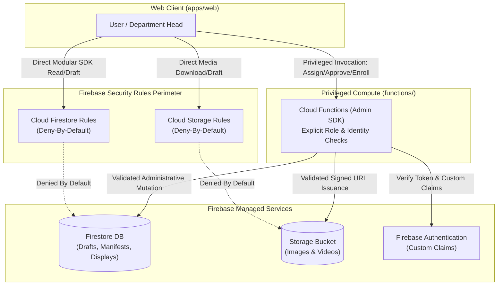

# Aura DIMS - System Architecture Specification

**Company:** Aurainteract Private Limited  
**Product:** Aura Digital Information Management System (Aura DIMS)  
**System Purpose:** Enterprise Digital Signage and Content Management Platform  

---

## 1. Monorepo Architecture & Service Boundaries

Aura DIMS adopts a modular monorepo layout managed by `pnpm workspaces`. This isolates dependencies, establishes clear interface contracts, and prevents leaking backend privileges into client bundles.

```
aura-dims/
├── apps/
│   └── web/                   # Frontend Web Application (React + Vite + Tailwind)
├── functions/                 # Backend Compute & Privileged APIs (Cloud Functions v2)
├── packages/
│   └── display-schema/        # Shared Domain Schemas, Manifest Types & Interfaces
├── player/                    # Signage Player Client Runtime (Documented Placeholder)
├── firebase/
│   └── emulators/data/        # Persistent Local Emulator State
├── docs/                      # Technical Documentation & Service Architecture
└── tests/
    ├── rules/                 # Security Rules Unit Tests
    └── e2e/                   # Playwright Browser Smoke Suite
```

### Boundary Definitions

1. **`apps/web/` (Client Layer):**
   - Implements the administrative portal, visual creator studio, and scheduling consoles.
   - Connects directly to Firebase via the modular Web SDK.
   - **Allowed Client Actions:** Read-only access to published public assets and authorized departmental draft edits.
   - **Forbidden Client Actions:** Direct role self-assignment, direct approval of publications, direct issuance of device credentials, and direct writes to system audit logs.

2. **`functions/` (Backend Privileged Layer):**
   - Cloud Functions for Firebase (v2) implemented in TypeScript and deployed to the `asia-south1` (Mumbai) region.
   - Operates with elevated Firebase Admin SDK privileges.
   - **Mandatory Policy:** Because the Admin SDK completely bypasses Firestore and Storage Security Rules, all Cloud Functions must implement explicit, granular caller identity and role checks before executing mutations.

3. **`packages/display-schema/` (Contract Layer):**
   - Shared TypeScript types, Zod/domain schemas, manifest definitions, and language enumerations (`en`, `gu`, `hi`).
   - Ensures type parity between the administrative frontend, cloud functions, and digital display players.

4. **`player/` (Edge Display Runtime):**
   - Autonomous digital display client runtime (Android kiosk, Web PWA, or Electron).
   - Operates on a pull-and-verify model without direct dependency on cloud backend uptime for slide sequencing.

---

## 2. Privilege Separation & Authorization Model



### 2.1 Core Authorization Principles
1. **Deny by Default:** Cloud Firestore and Cloud Storage start with a total deny posture (`allow read, write: if false;`).
2. **No Role Self-Assignment:** Users can never alter their own roles or custom claims.
3. **No Sole Email Domain Checks:** Authorization is strictly backed by cryptographically signed Firebase Custom Claims issued by backend Cloud Functions.
4. **No Default Known Administrator:** System administrators are provisioned explicitly through authenticated administrative initialization routines rather than pre-seeded hardcoded accounts.
5. **UI Visibility Is Not Security:** Hiding buttons or routes in the web application never substitutes for backend authorization.

### 2.2 Future Role Hierarchy
- **System Administrator:** Unrestricted management of all sites (Ahmedabad, Vadodara, Surat, Rajkot), all departments, user provisioning, and emergency network broadcast overrides.
- **Department Head:** Restricted scope managing content and playlists belonging strictly to their assigned department (e.g. HR, Operations, Safety).
- **Explicit Digital Display Assignments:** A Department Head can only schedule and publish content to digital displays that have been explicitly assigned to them by an Administrator.
- **Digital Display Device Identity:** Digital display players authenticate using separate, distinct device credentials (device tokens/mTLS) rather than human user credentials.

---

## 3. Autonomous Offline Signage Player Architecture

Digital displays deployed in factory floors, lobbies, and industrial sites frequently experience severed or intermittent network connectivity.

> [!IMPORTANT]
> **Firestore offline persistence alone is NOT a complete digital signage solution.**
> Cache eviction, incomplete collection reads, and dependency on live server clocks cause signage screens to fail or display black screens during outages. Aura DIMS implements an autonomous pull-and-verify architecture.

### 3.1 Architectural Pillars of Offline Playback

1. **Versioned Publication Manifest:**
   - Playlists and schedules compile into an immutable, versioned manifest (`PublicationManifest`).
   - The manifest specifies exact slide display duration in milliseconds, sequence order, media asset URLs, and SHA-256 file checksums.
2. **Local Hardware Clock Execution:**
   - Time-based playlist transitions and dayparting evaluate locally against the hardware clock configured to `Asia/Kolkata`.
   - Slide changes NEVER depend on a scheduled Cloud Function firing over the network.
3. **Atomic Verification & Staging:**
   - The player downloads assets to persistent local storage (IndexedDB or local file system).
   - Before activating a new manifest, the player computes the SHA-256 hash of every asset.
   - The player switches to the new publication **only after 100% of required media files are validated locally**.
4. **Last-Known-Good (LKG) State:**
   - If a new manifest download fails, is corrupted, or times out, the digital display continues looping the Last-Known-Good publication without interruption.
5. **Fallback Content:**
   - If a publication reaches its hard expiration timestamp without an update, the player switches to localized fallback emergency notices or company branding slides stored permanently on device.
6. **Telemetry & Reconciliation:**
   - During offline periods, proof-of-play events and heartbeats are recorded in a local FIFO queue.
   - Upon reconnection, telemetry is batched and reconciled with Cloud Firestore.

---

## 4. Multi-Project Firebase Strategy

Aura DIMS isolates development, testing, and production across distinct Firebase project configurations:

| Environment | Firebase Project ID | Purpose & Access Boundary |
| :--- | :--- | :--- |
| **Local Development** | `demo-aura-dims` | Offline Firebase Emulator Suite. Zero cloud credentials or billing required. |
| **Staging** | `aura-dims-staging` | Pre-production testing environment with simulated digital display devices. |
| **Production** | `aura-dims-prod` | Live multi-site signage deployment in `asia-south1` (Mumbai). |

---

## 5. Legacy Django / PostgreSQL Scaffold Retirement Proposal

During workspace auditing, no active Django or PostgreSQL code files were found in `aura-dims`. If an earlier scaffold is discovered in adjacent directories or backups, the following retirement plan will be executed without data loss:

1. **Preserve Repository Integrity:** Archive the entire Django codebase into an immutable branch (`archive/legacy-django-backend`) or dedicated read-only repository.
2. **Schema Extraction:** Execute `pg_dump --schema-only` into `docs/legacy-reference/schema.sql` to verify table definitions against the Firestore data model.
3. **Data Mapping & Verification:** Verify that all entity relationships (users, displays, schedules) map cleanly to Firestore collections.
4. **Deprecate Without Deletion:** Mark legacy endpoints as deprecated and safely power down legacy database containers after Aura DIMS reaches operational parity.

