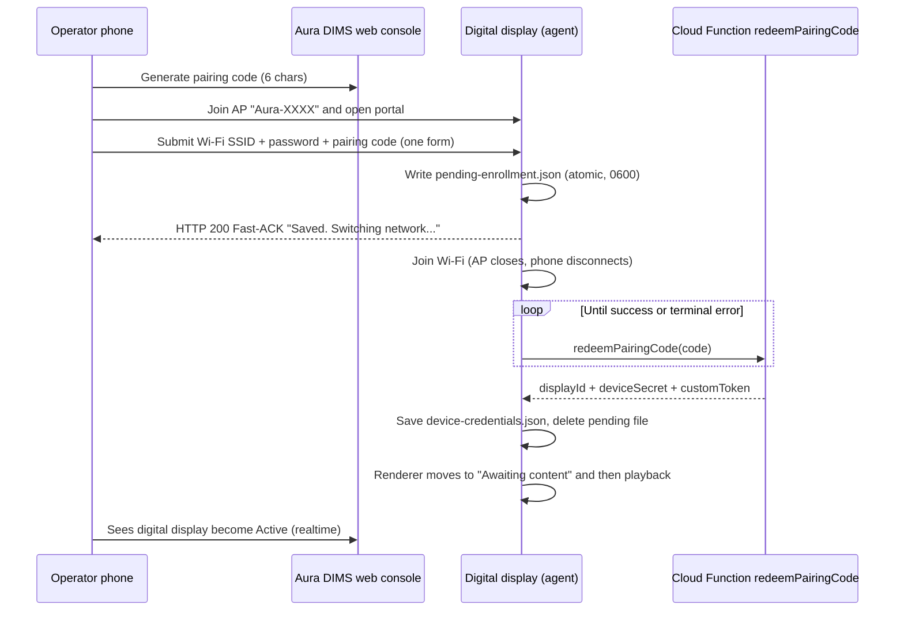
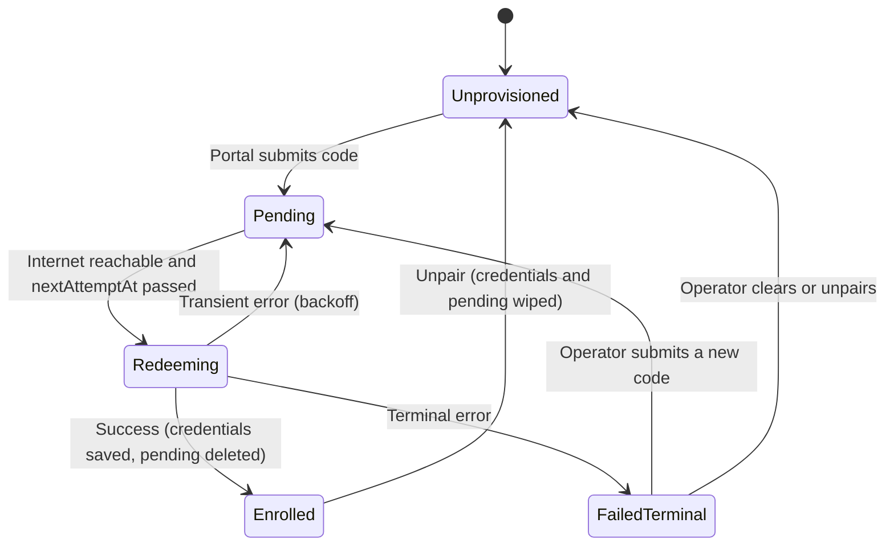

# Digital Display Onboarding: Store-and-Forward Pairing (Mobile-Only)

**Product:** Aura DIMS (Aurainteract Private Limited)
**Status:** Design spec, ready for implementation
**Audience:** Any developer or AI agent picking up this work. Read this whole file before writing code.
**Related files:** `player/src/agent/{captivePortal,identity,supervision,wifiManager,localServer,index}.ts`, `player/src/renderer/renderer.js`, `player/setup/{server.cjs,setup.html}`, `functions/src/fleetAdmin.ts`, `functions/src/operational.ts`

> [!IMPORTANT]
> Follow `AGENTS.md`: always write **"digital display"** in user-facing copy, logs and docs (never "screen", "monitor", "TV"). Local tests run only against the Firebase Emulator (`demo-aura-dims`). Pairing redemption stays a backend Cloud Function (`redeemPairingCode`); the device never gets Admin SDK credentials.

---

## 1. Problem

A Raspberry Pi digital display has **no keyboard**. The operator has only a mobile phone. Today the onboarding flow is broken:

1. The digital display boots into AP mode (`Aura-XXXX`, IP `10.42.0.1`) because it has no internet.
2. The operator joins the AP from a phone and opens the captive portal.
3. To redeem a pairing code, the Pi needs **internet** (the code goes to the `redeemPairingCode` Cloud Function).
4. The operator submits Wi-Fi credentials, so the Pi joins the Wi-Fi and **tears down the AP** (`WifiManager.stopApMode()`, single radio).
5. The phone loses its link to `10.42.0.1`. A pairing code submitted after that never reaches the Pi.

Field evidence (19 Nov 2026, Pi `Aurakiosk`): Wi-Fi join at 18:18:25, AP removed right away, **no `/api/pair` request reached the agent afterwards**. The HDMI output stayed on the "Digital Display Enrollment" card (which needs a keyboard), and the web console stayed at `pending_enrollment`.

**This is a deadlock:** before the Wi-Fi switch there is no internet to redeem the code, and after the switch the phone can no longer reach the Pi.

## 2. Required behaviour (owner's decision)

> The pairing code is stored in a JSON file on the Pi. If the digital display is not registered and has a stored code that has not yet been redeemed, it tries to register with the Aura DIMS cloud **as soon as it has internet**. Everything is done from a mobile phone.

This is the standard **store-and-forward / deferred claim** pattern.

---

## 3. Industry research: how professional systems do it

| System | Onboarding pattern | Lesson for Aura DIMS |
| :--- | :--- | :--- |
| **Google Home / Nest, Chromecast** | The phone joins the device SoftAP (or BLE) and sends Wi-Fi credentials **and** an account claim token in one step. The device joins Wi-Fi, then registers itself with the cloud. The phone checks the cloud for success, not the device. | Collect Wi-Fi + pairing code in **one submission**. Confirm success through the **cloud/web console**, not through the AP. |
| **AWS IoT Fleet Provisioning by Claim** | The device holds a claim credential, connects when online, and swaps it for a permanent identity. It retries until successful. | Persist the claim (pairing code) and redeem it whenever connectivity appears, with backoff. |
| **Azure IoT DPS** | Registration runs on the device at first connection, with retry and exponential backoff. Registration state is kept on disk. | Use a small state machine with a durable state file. Tell transient errors apart from terminal ones. |
| **Espressif / Particle SoftAP provisioning** | The device sends Fast-ACK, stores credentials, switches network, and falls back to AP if the join fails. The phone app reconnects to normal Wi-Fi and polls the cloud. | Fast-ACK already exists in Aura DIMS. Add AP fallback on failure so the pending code survives. |
| **Signage SaaS (Yodeck, ScreenCloud, OptiSigns, Xibo)** | The display shows a code on its own HDMI output. The admin types that code into the web dashboard (device-initiated pairing). | A good **future** option (see §11). It removes code entry on the phone completely. Out of scope for this task. |

**Shared principles:**
1. **Provision in one step.** Never require the phone to talk to the device after the device leaves AP mode.
2. **Durable intent.** Write the claim to disk *before* changing network state.
3. **Idempotent, retried redemption** with exponential backoff, jitter and network-change triggers.
4. **Classify errors.** Transient errors are retried. Terminal errors stop and are shown to the operator.
5. **Show status on the device itself.** The HDMI output shows clear text, because there is no keyboard and the phone may be offline.
6. **Have a recovery path.** If something fails, the device returns to AP mode, keeps or clears the intent as needed, and tells the operator what to do next.
7. **Confirm through the cloud.** The operator watches the web console turn `active`.

---

## 4. Target user journey (mobile only)



If the Wi-Fi join fails (wrong password, no internet), the Pi **re-opens the AP**. The portal shows the last error, and the pending code is kept so the operator only fixes the Wi-Fi details.

---

## 5. Pending enrollment state

### 5.1 File

- Path: `${config.credentialsDir}/pending-enrollment.json` (on the Pi this is `/home/aura/player/data/credentials/pending-enrollment.json`, same directory as `device-credentials.json`, mode `0700` dir and `0600` file).
- Write atomically: write `*.tmp`, `fsync`, then `rename` (same as `DeviceIdentity.saveCredentials`).

### 5.2 Schema (add to `packages/display-schema` as `PendingEnrollment`)

```jsonc
{
  "schemaVersion": 1,
  "pairingCode": "7K2M9P",          // uppercase A-Z0-9, length 6 (validate)
  "submittedAt": "2026-11-19T12:47:10.000Z",
  "source": "captive_portal",        // "captive_portal" | "lan_portal" | "cli"
  "state": "pending",                // "pending" | "redeeming" | "failed_terminal"
  "attempts": 0,
  "lastAttemptAt": null,
  "nextAttemptAt": null,
  "lastError": null,                 // { "code": "network_unavailable", "message": "..." }
  "wifiSsid": "AuraInteract200_5G"   // informational only, never store the Wi-Fi password here
}
```

### 5.3 State machine



Rules:
- If `device-credentials.json` exists, **ignore and delete** any pending file (already enrolled).
- Only **one** redemption may be in flight. Use an in-memory mutex. Persist `state: "redeeming"` before calling, and treat a leftover `"redeeming"` at boot as `"pending"`.
- A new code submission **replaces** the pending file and resets `attempts`.

---

## 6. Redemption worker (`EnrollmentWorker`)

Create `player/src/agent/enrollmentWorker.ts`. Wire it up in `index.ts` and `supervision.ts`.

### 6.1 Triggers
1. Agent start (after `loadConfig`), when not enrolled and a pending file exists.
2. Right after `WifiManager.connectNetwork()` succeeds (from the captive portal flow).
3. A periodic tick every 15 s while a pending file exists (cheap check of `nextAttemptAt`).
4. A connectivity change detected by the existing `wifiTimer` in `supervision.ts` (offline to online).

### 6.2 Internet check before calling
Reuse WifiManager's connectivity probe, or do a lightweight HTTPS HEAD (5 s timeout) to the Functions host. Skip the attempt if offline. Do not count it as an attempt.

### 6.3 Backoff
`delay = min(5 min, 5 s × 2^attempts) ± 20 % jitter`. Reset when connectivity transitions offline to online.

### 6.4 Error classification (from `redeemPairingCode` in `functions/src/fleetAdmin.ts`)

| Server / transport result | Class | Action |
| :--- | :--- | :--- |
| Network error, DNS failure, timeout, `unavailable`, HTTP 5xx | Transient | Back off and retry |
| `resource-exhausted` (rate limit 10 / 300 s per IP) | Transient | Back off at least 60 s |
| `not-found` "Invalid pairing code" | **Terminal** | `failed_terminal`, show "Invalid code" |
| `failed-precondition` "already been consumed" | **Terminal** (but see note) | Show "Code already used" |
| `failed-precondition` "expired" | **Terminal** | Show "Code expired, generate a new one" |
| `failed-precondition` "not in pending_enrollment" | **Terminal** | Show "Digital display already active, unpair in web console first" |
| `invalid-argument` | Terminal | Show "Invalid code format" |

> [!NOTE]
> **Idempotency edge case:** if the server consumed the code but the response was lost (network dropped mid-call), the retry gets "already consumed". The device then has no credentials, so the operator must generate a new code. That is acceptable for v1. Optional v2: return the same credentials if `redeemPairingCode` is replayed within 2 min by a client sending the same `clientNonce` (store the nonce in the pending file and in `pairingCodes/{verifier}`).

### 6.5 On success
1. `identity.pairWithCode()` already saves credentials and signs in.
2. Delete `pending-enrollment.json`.
3. `syncEngine.checkForUpdates()` and `server.triggerRendererRefresh()`.
4. Log `Digital display enrolled via stored pairing code` (never log the code; `logger.ts` already redacts `pairingCode=`).

### 6.6 Code TTL
The code TTL is `AURA_PAIRING_CODE_TTL_SECONDS` (default **600 s**, max 3600, `functions/src/operational.ts`). A field install can take longer than 10 minutes.
- Recommend setting the production env to **3600** and raising the allowed maximum to `86400` (24 h) for field onboarding. Codes are single-use, hashed (`pairingCodeVerifier`) and rate-limited.
- The web console pairing modal must show the expiry countdown (already returned as `expiresAt`).

---

## 7. Captive portal changes (`captivePortal.ts` and `setup.html`)

### 7.1 Unified onboarding form
When the digital display is **not enrolled**, the Wi-Fi form shows a third field:

- `Pairing Key Code` (optional, 6 chars, auto-uppercase, `A-Z0-9`), with this help text: "Generate this in Aura DIMS → Displays → Pairing Code. The digital display will register itself automatically once it is online."
- Button label: "Connect & Register Digital Display".

### 7.2 `POST /api/wifi/connect` (extend)
Body: `{ ssid, password, overridePassword, pairingCode? }`
1. Validate `pairingCode` if present (regex `^[A-Z0-9]{6}$`).
2. **Write the pending file before anything else.**
3. Fast-ACK HTTP 200: `{ success, pending: true, enrollmentQueued: boolean }`.
4. After 600 ms, call `wifiManager.connectNetwork(...)`. On success, `enrollmentWorker.kick()`.
5. On failure, re-enable the AP (`startApMode()` and `captivePortal.start(80)`), write `last-error`, and **keep** the pending file.

### 7.3 New `POST /api/enrollment/pending`
Stores or replaces a code **without** changing the network. This covers the Ethernet case and the case where the device is already online on Wi-Fi.
- If the device is online, kick the worker right away and wait up to 15 s for the result, then return `{ state, displayId?, error? }`.
- If the device is offline, return `{ state: "pending" }`.

### 7.4 `GET /api/device/info` (extend)
Add `pendingEnrollment: { state, attempts, lastError, codeHint: "••••9P" } | null`. **Never return the full code.**

### 7.5 Register modal (existing)
Change it to call `/api/enrollment/pending` instead of `/api/pair`, and show a queued or redeemed status. Keep `/api/pair` as a thin alias for backward compatibility.

### 7.6 Success page copy (after Fast-ACK)
"✓ Saved. The digital display is joining **{ssid}** and will register itself with Aura DIMS. Reconnect your phone to your normal Wi-Fi and watch the digital display turn **Active** in the Aura DIMS web console. If it does not join, the hotspot **{apSsid}** will reappear within about 60 s."

### 7.7 Unpair (`POST /api/unpair`)
It must also delete `pending-enrollment.json`.

---

## 8. HDMI renderer status (no keyboard)

`player/src/renderer/renderer.js` → `renderSetupScreen()` currently shows a keyboard input box, which is useless on a headless kiosk. Replace it with a status-driven card that reads `/api/status`. Extend `/api/status` in `localServer.ts` with `pendingEnrollment` and `apMode`.

| State | Digital display shows |
| :--- | :--- |
| Unprovisioned + AP active | "Connect your phone to Wi-Fi **Aura-XXXX** (password `12345678`), then open http://10.42.0.1". Also show a **QR code** in the format `WIFI:T:WPA;S:Aura-XXXX;P:12345678;;` so the phone joins with one tap. Generate the QR locally because the renderer CSP blocks external images (vendor a tiny QR lib). |
| Pending, offline | "Pairing code saved (••••9P). Waiting for internet…" |
| Redeeming | "Registering digital display with Aura DIMS… (attempt n)" |
| Failed terminal | Reason ("Code expired" / "Invalid code" / "Already used"), plus the instruction "Generate a new code in Aura DIMS and reconnect to Aura-XXXX". |
| Enrolled, no package | Existing "Awaiting content" screen |

Keep the manual input form **only** when `?debug=1` is set (developer use).

---

## 9. Consolidate the two setup portals (prerequisite cleanup)

There are currently **two** HTTP servers that try to own port 80 in AP mode:
- `aura-setup-portal.service` runs `player/setup/server.cjs` (root, port 80). It is started by `player/setup/wifi-supervisor.sh` and builds its own AP `Aura-<serial>` with password `aura12345678`.
- `CaptivePortalServer` inside the agent (`supervision.ts` → `captivePortal.start(80)`), with AP `Aura-<MAC>` and password `12345678`.

This is why operators saw two different SSIDs (`Aura-1518` vs `Aura-4EFE`) and two different passwords.

**Decision:** the agent's `CaptivePortalServer` is the single source of truth.
- Disable `aura-setup-portal.service` and `wifi-supervisor.sh`'s AP creation in the installer (`docs/player-installation.md`, install scripts).
- Keep `server.cjs` only as a fallback if the agent fails to start. If it stays, it must write the **same** `pending-enrollment.json` (same schema), so the agent redeems the code on next start. It must **not** shell out to `node index.js --pair`.
- Use one AP password policy everywhere. Document it in `operator-guide.md`.

---

## 10. Implementation checklist

1. **Schema:** add `PendingEnrollment` type to `packages/display-schema`.
2. **Store:** `player/src/agent/pendingEnrollment.ts` with `read()`, `write()`, `clear()`, `update()`. Use atomic writes and `0600`.
3. **Worker:** `player/src/agent/enrollmentWorker.ts` (triggers, mutex, backoff, classification, success hooks).
4. **Wiring:** `index.ts` (start the worker when not enrolled; keep `--pair` CLI by writing the pending file and kicking the worker), and `supervision.ts` (pass the worker to `CaptivePortalServer`, kick on connectivity change).
5. **Captive portal:** unified form, extended `/api/wifi/connect`, new `/api/enrollment/pending`, extended `/api/device/info`, unpair clears pending, AP fallback on join failure.
6. **Local server and renderer:** `/api/status.pendingEnrollment`, a new keyboard-free status card with QR.
7. **Functions:** raise the TTL ceiling (optional `clientNonce` idempotency in v2).
8. **Portal consolidation:** §9.
9. **Docs:** update `operator-guide.md`, `player-installation.md`, `player-troubleshooting.md`.

## 11. Testing

**Unit tests (Vitest, `tests/player/`)**
- Pending store: atomic write, `0600` perms (Linux only), corrupt JSON is treated as absent, schema validation.
- Worker: offline means no attempt; a transient error is retried with growing delay; each terminal error code leads to `failed_terminal`; success deletes the file and calls refresh; a leftover `redeeming` state resumes at boot; an enrolled device deletes the pending file.
- Captive portal: `/api/wifi/connect` with `pairingCode` writes the file **before** the Fast-ACK response; `/api/device/info` masks the code; `/api/unpair` deletes both files; invalid codes are rejected with 400.

**Emulator integration (`demo-aura-dims`)**
- Generate a code with the admin callable, write the pending file, start the agent offline, then online, and assert that `displays/{id}.lifecycle == 'active'`.

**Manual acceptance on the Pi (mobile only, Ethernet unplugged)**
1. Web console: unpair the digital display, then generate a code.
2. Maintenance → "Clear Wi-Fi & Reboot". The HDMI output shows the AP SSID and QR.
3. Phone: scan the QR or join the AP, then open the portal.
4. Enter Wi-Fi + code, then submit. The phone shows the "Saved…" message.
5. Within about 60 s: the HDMI output shows "Registering…" and then "Awaiting content". The web console shows **Active** without a page refresh.
6. Negative test: enter a wrong Wi-Fi password. The AP comes back, the portal shows the error, the code is still pending (`••••9P`), and fixing the password completes enrollment.
7. Negative test: use an expired code. The HDMI output shows "Code expired…", and submitting a fresh code through the portal recovers.

## 12. Security notes
- The pairing code is a short-lived, single-use, hashed-at-rest bearer secret. Store it only in a `0600` file and delete it on success or terminal failure.
- Never log or return the full code. Mask it as `••••XY`.
- The portal is only exposed on the AP interface (`10.42.0.1`). If a LAN portal is added later, require the admin PIN for `/api/enrollment/pending` and `/api/unpair`.
- Redemption authorization stays server-side (`redeemPairingCode` checks lifecycle, expiry, consumption and rate limit).

## 13. Future option: device-initiated pairing (signage-industry standard)
After the digital display is online, it calls an unauthenticated `requestDevicePairing` function. That function returns a short code shown **on the HDMI output**. The admin types the code into the web console, which binds it to a display record, and the device polls for its credentials. This removes code entry on the phone entirely (it is how Yodeck and ScreenCloud work). Consider it after store-and-forward ships.
